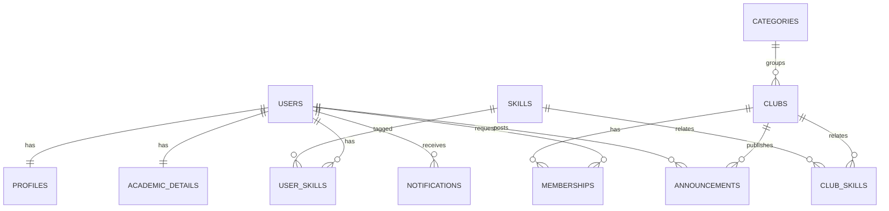
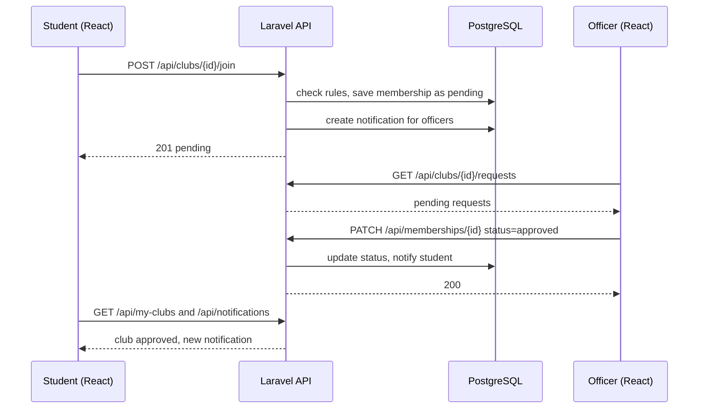

# CampusClubs: Student Organization / Club Membership System

*An extension of the CampusProfile app*

---

## 1. Overview

**CampusClubs** is a mobile-responsive web application that lets students discover campus organizations, join or leave them, and see their memberships on their student profile. Club officers manage their members and post announcements, while school administrators approve clubs and oversee the whole system.

It reuses the CampusProfile login, profile, and skills/interests data, so the existing prototype carries over directly.

### 1.1 Problem Statement
Students often do not know which clubs exist, how to join them, or when they hold activities. Membership records are usually kept on paper or in chat groups, which makes them hard to maintain, verify, or report.

### 1.2 Objectives
- Give students one place to browse and join campus organizations.
- Replace paper-based membership records with a searchable database.
- Let officers manage members and communicate announcements.
- Let administrators approve clubs and monitor membership.
- Show each student's club memberships on their profile.

### 1.3 Scope
**In scope:** accounts, profiles, club directory, join/leave with approval, member roster, announcements, roles, notifications, admin management.

**Out of scope (for this version):** online payments for membership fees, chat messaging, event ticketing, and attendance tracking.

---

## 2. Users and Roles

| Role | Description | Main abilities |
|---|---|---|
| **Student** | Regular user | Browse clubs, request to join, leave, view announcements, edit own profile |
| **Club Officer** | Student who leads a club (President, Secretary, etc.) | Everything a student can do, plus approve or reject join requests, manage the roster, post announcements, edit club info |
| **Administrator** | School staff or faculty | Approve or deactivate clubs, assign advisers, manage users, view reports |

A student can be an officer of one club and a regular member of others.

---

## 3. Features

The following lists describe intended scope. Implementation status is audited in Sections 4 and 17; items in the scope list are not all implemented.

### 3.1 Student Features
1. **Register and log in** with Student ID or email and password.
2. **Remember me** and **forgot password** (reset by email).
3. **Home dashboard** with a greeting, profile card, my clubs, and latest announcements.
4. **Browse clubs** with search and category filter (Academic, Arts, Sports, Technology, Community Service, Religious, Others).
5. **View club details**: description, adviser, officers, member count, schedule, and contact info.
6. **Request to join** a club, with an optional message to the officers.
7. **Track request status**: Pending, Approved, Rejected, Cancelled.
8. **Cancel a pending request.**
9. **Leave a club.**
10. **My Clubs** list showing all current memberships and the role held in each.
11. **View announcements** from joined clubs.
12. **Club recommendations** based on the skills and interests in the student's profile.
13. **Edit profile**: name, course and year, email, phone, address, photo, interests/skills.
14. **Notifications** (bell icon) for request results and new announcements.
15. **Settings**: change password, notification preferences, log out.

### 3.2 Club Officer Features
1. **Officer dashboard** for the clubs they manage.
2. **Review join requests**: approve or reject, with an optional reason.
3. **Member roster**: view, search, and remove members.
4. **Assign officer positions** to members (President, Vice President, Secretary, Treasurer, Member).
5. **Post announcements** with a title, message, and optional image.
6. **Edit announcements** and delete them.
7. **Edit club info**: description, logo, schedule, contact details.
8. **Open or close membership** (toggle whether the club is accepting new members).
9. **Export member list** (CSV).

### 3.3 Administrator Features
1. **Admin dashboard** with totals for users, clubs, memberships, and pending approvals.
2. **Approve or reject new club registrations.**
3. **Assign or change club advisers.**
4. **Deactivate or reactivate clubs.**
5. **Manage users**: view, search, disable, reset password.
6. **Manage categories.**
7. **Reports**: members per club, most popular clubs, students without any club, membership growth.
8. **System-wide announcements.**

---

## 4. Screen List

This table distinguishes real routable screens from items represented by sections or controls within another page. Routes are declared in `frontend/src/App.tsx`; `frontend/src/main.tsx` mounts the app.

| # | Document screen name | Actual route/page | Status and difference |
|---|---|---|---|
| 1 | Login | `/auth/login` — `LoginPage` | Implemented |
| 2 | Create Account | `/auth/signup` — `SignupPage` | Implemented |
| 3 | Forgot Password | `/auth/forgot-password` — `ForgotPasswordPage` | Implemented |
| 4 | Home | `/home` — `HomePage` | Implemented; includes profile card, Quick access, My clubs preview, and announcements preview |
| 5 | Edit Profile | `/profile/edit` — `EditProfilePage` | Implemented |
| 6 | Personal Information | No separate route; personal details appear on `/profile` and `/profile/edit` | No dedicated screen; partially covered by Profile |
| 7 | Academic Details | `/profile/academic` — `AcademicDetailsPage` | Implemented |
| 8 | Skills & Interests | `/profile/skills` — `SkillsInterestsPage` | Implemented |
| 9 | Club Directory | `/` — `ExplorePage` | Implemented (called “Explore clubs” in navigation) |
| 10 | Club Details | `/clubs/:id` — `ClubDetailsPage` | Implemented; public officer list is not shown |
| 11 | Join Request | No separate route; request/cancel/leave action is on Club Details | Inline action, not a screen |
| 12 | My Clubs | `/my-clubs` — `MyClubsPage` | Implemented; pending proposals and memberships are listed here |
| 13 | Announcements Feed | `/announcements` — `AnnouncementsPage` | Implemented |
| 14 | Notifications | No separate route; `NotificationBell` opens a dropdown | Partial screen coverage; notification list/actions are in the dropdown |
| 15 | Settings | No settings route | Missing as a screen; logout is in the shared layout and password reset is separate |
| 16 | Officer Dashboard | `/clubs/:id/officer` — `OfficerPage` | Partial match; tools are per club, not a multi-club dashboard |
| 17 | Join Requests List | `/clubs/:id/officer`, section in `OfficerPage` | Implemented as a section |
| 18 | Member Roster | `/clubs/:id/officer`, section in `OfficerPage` | Implemented as a section; roster search/export are absent |
| 19 | Post / Edit Announcement | `/clubs/:id/officer`, section in `OfficerPage` | Implemented as a section; title/body only, no image |
| 20 | Edit Club Info | `/clubs/:id/officer`, section in `OfficerPage` | Implemented as a section; settings include description, adviser, schedule, contact, tags, accepting toggle |
| 21 | Admin Dashboard | `/admin` — `AdminPage` | Implemented |
| 22 | Manage Clubs | `/admin`, approvals section in `AdminPage` | Partial; pending proposals can be approved/rejected, no active-club lifecycle controls |
| 23 | Manage Users | `/admin/users` — same `AdminPage` component | Partial; list and enable/disable are present; search and password reset are absent |
| 24 | Reports | `/admin/reports` — same `AdminPage` component | Partial; totals, students without a club, and members-per-club are shown; not all proposed report types exist |

### Screens present in the app but not listed above

- `/auth/reset-password` — `ResetPasswordPage` (public reset form).
- `/clubs/propose` — `ProposeClubPage` (student proposal form and pending confirmation).
- `/profile` — `ProfilePage` (profile overview, separate from Edit Profile).
- `/` is the routed Explore page; the extra files `frontend/src/pages/guest/home.tsx` and `frontend/src/pages/guest/club-details.tsx` are not imported by `App.tsx` and are not reachable screens.
- `/admin/users` and `/admin/reports` are route aliases to the same combined `AdminPage`; they do not render distinct page components.

### 4.1 Navigation and Home Quick Access

The shared navigation links are `Home` (`/home`), `Explore clubs` (`/`), `My clubs` (`/my-clubs`), `Announcements` (`/announcements`), and `Profile` (`/profile`), with `Admin` (`/admin`) for administrators. Logout is a control in the profile area. There is no Settings item. The responsive layout uses the same navigation destinations.

Home's Quick access cards link only to **Academic details** and **Skills & interests**. My clubs and announcements appear in separate Home sections; profile editing is linked from the profile card. There is no Personal Information Quick access card.

---

## 5. Navigation Flow

```
Login ──► Home (`/home`)
 │          ├─► Quick access ─► Academic details / Skills & interests
 │          ├─► My clubs / Announcements
 │          └─► Profile ─► Edit profile
 │
 ├─► Create Account ─► Login
 └─► Forgot Password ─► Reset Password ─► Login

Explore clubs (`/`) ─► Club Details (`/clubs/:id`) ─► join/cancel/leave action
Club Proposal (`/clubs/propose`) ─► My Clubs (`/my-clubs`, pending status)
Notification bell ─► notification dropdown; Log out ─► Login

Officer only:
Club Details ─► per-club Officer tools (`/clubs/:id/officer`) ─► requests / roster / announcements / club settings

Admin only:
Admin (`/admin`, `/admin/users`, `/admin/reports`) ─► one combined page with approvals / users / reports
```

---

## 6. Main Workflows

### 6.1 Join a Club
1. Student opens **Explore clubs** (`/`) and searches, filters, or sorts.
2. Student opens **Club Details**.
3. If the club is accepting members and the student is not already a member, the **Join** button is active.
4. Student uses the join action on Club Details. The current UI does not collect the optional message, though the API accepts it.
5. System saves the request as **Pending** and notifies the club officers.
6. An officer approves or rejects.
7. System updates the status and notifies the student.
8. If approved, the club appears in **My Clubs**. It is not listed on the Profile page.

### 6.2 Create a New Club
1. An authenticated student or officer opens `/clubs/propose` and submits name, category, description, adviser, meeting schedule, contact email, and up to six tags. The form has no logo field.
2. The administrator reviews it.
3. If approved, the club becomes active and the proposer becomes its **President**.

### 6.3 Post an Announcement
1. An officer opens Club Details and follows the link to per-club Officer tools (`/clubs/:id/officer`).
2. Officer writes a title and message and submits the form. The current form has no image field.
3. System saves it and sends a notification to all members of that club.

### 6.4 Leave a Club
1. Student opens **My Clubs**.
2. Student uses **Leave club** or **Cancel request** on a club card (there is no confirmation dialog).
3. The membership row changes to `left` or `cancelled`; it retains its latest status, not a full history of prior changes.

---

## 7. Business Rules

1. A student may join multiple clubs. The database keeps one membership row per student and club; reapplication updates that row, so it does not preserve a full status history.
2. A student cannot send a new request while a **Pending** request exists or while already approved.
3. A rejected student may reapply after **7 days**.
4. A proposal creates the proposer as an approved **President**. Club advisers are optional in validation, so the system does not require every club to have an adviser.
5. The last President cannot leave or be demoted. The membership removal action does not apply that safeguard, so a club's last President can currently be removed by an officer; this is a rule gap.
6. Only active clubs that are accepting members can accept a request; pending, inactive, rejected, or closed clubs reject new requests.
7. Student ID is unique at registration and the edit-profile form makes it read-only.
8. Only a club officer or administrator can post or edit that club's announcements.
9. Users are disabled/enabled rather than deleted. Clubs have status values (`pending`, `active`, `inactive`, `rejected`); the schema supports soft deletes for clubs, but the API exposes no club-delete action.
10. Membership rows are retained when a member leaves, is removed, or a request is cancelled, but each row stores only its latest state and timestamps rather than a complete history.

---

## 8. Database Design

### 8.1 Tables

**users**

| Field | Type | Notes |
|---|---|---|
| id | PK | |
| student_id | varchar, unique | e.g., 2024-12345 |
| email | varchar, unique | |
| password | varchar | Hashed by Laravel; never stored in plain text |
| role | varchar | `USER` or `ADMIN` |
| is_active | boolean | |
| deleted_at | timestamp, nullable | Soft-delete support |
| created_at | datetime | |

**profiles**

| Field | Type | Notes |
|---|---|---|
| user_id | PK, FK → users | |
| full_name | varchar | |
| phone | varchar, nullable | |
| address | varchar, nullable | |
| photo_path | varchar, nullable | Stored path; API returns a photo URL |
| created_at / updated_at | timestamp | |

**academic_details**

| Field | Type | Notes |
|---|---|---|
| user_id | PK, FK → users | |
| course | varchar | e.g., BSIT |
| year_level | unsigned tinyint | Defaults to 1 |
| section | varchar, nullable | |

**skills**

| Field | Type |
|---|---|
| id | PK |
| name | varchar, unique |

**user_skills**

| Field | Type |
|---|---|
| user_id | FK → users |
| skill_id | FK → skills |

**categories**

| Field | Type |
|---|---|
| id | PK |
| name | varchar, unique |
| slug | varchar, unique |

**clubs**

| Field | Type | Notes |
|---|---|---|
| id | PK | |
| name | varchar, unique | |
| slug | varchar, unique | |
| category_id | FK → categories | |
| description | text | |
| logo_url | varchar | |
| adviser_name | varchar, nullable | |
| meeting_schedule | varchar, nullable | |
| contact_email | varchar, nullable | |
| member_count | unsigned int | Cached count field |
| is_accepting_members | boolean | |
| status | varchar | `pending`, `active`, `inactive`, `rejected` |
| created_by | nullable FK → users | |
| deleted_at | timestamp, nullable | Soft-delete support |
| created_at | datetime | |

**club_skills** *(used for recommendations)*

| Field | Type |
|---|---|
| club_id | FK → clubs |
| skill_id | FK → skills |

**memberships**

| Field | Type | Notes |
|---|---|---|
| id | PK | |
| user_id | FK → users | |
| club_id | FK → clubs | |
| role | varchar | `member`, `secretary`, `treasurer`, `vice_president`, `president` |
| status | varchar | `pending`, `approved`, `rejected`, `cancelled`, `left`, `removed` |
| message | text | Optional note from the student |
| decision_reason | text | Optional note from the officer |
| requested_at | datetime | |
| decided_at | datetime | |
| decided_by | nullable FK → users | |

There is a unique constraint on `(user_id, club_id)`, so membership state changes reuse the same row.

**announcements**

| Field | Type | Notes |
|---|---|---|
| id | PK | |
| club_id | nullable FK → clubs | `NULL` for system-wide |
| posted_by | FK → users | |
| title | varchar | |
| body | text | |
| image_url | nullable varchar | The API/UI do not currently upload an image |
| created_at | datetime | |

**notifications**

| Field | Type | Notes |
|---|---|---|
| id | PK | |
| user_id | FK → users | Recipient |
| type | varchar | `request_update`, `announcement`, `club_approved`, `system` |
| message | varchar | |
| reference_id | int | Related record |
| is_read | boolean | |
| created_at | datetime | |

**password_reset_tokens**

| Field | Type | Notes |
|---|---|---|
| email | varchar, primary key | Account email |
| token | varchar | Hashed reset token |
| created_at | nullable timestamp | |

### 8.2 Relationships

```
users 1 ──── 1 profiles
users 1 ──── 1 academic_details
users M ──── M skills            (via user_skills)
users M ──── M clubs             (via memberships)
clubs M ──── 1 categories
clubs M ──── M skills            (via club_skills)
clubs 1 ──── M announcements
users 1 ──── M announcements     (posted_by)
users 1 ──── M notifications
```

### 8.3 ER Diagram (Mermaid)



---

## 9. Permissions Matrix

| Action | Student | Officer (own club) | Admin |
|---|:---:|:---:|:---:|
| Register / log in | ✔ | ✔ | ✔ |
| Edit own profile | ✔ | ✔ | ✔ |
| Browse clubs | ✔ | ✔ | ✔ |
| Request to join / leave | ✔ | ✔ | ✔ |
| Approve / reject requests | ✘ | ✔ | ✔ |
| View member roster | ✘ | ✔ | ✔ |
| Remove a member | ✘ | ✔ | ✔ |
| Post announcements | ✘ | ✔ | ✔ |
| Edit club info | ✘ | ✔ | ✔ |
| Approve new clubs | ✘ | ✘ | ✔ |
| Change club status (API); pending approvals in UI | ✘ | ✘ | ✔ |
| Manage users | ✘ | ✘ | ✔ |
| View reports | ✘ | ✘ | ✔ |

These are API authorization capabilities. The current admin UI exposes a subset; see Section 17.1.

---

## 10. Validation Rules

| Field | Rule |
|---|---|
| Student ID | Required, format `YYYY-NNNNN`, unique; read-only on profile edit |
| Email | Required, valid email format, unique |
| Password | Minimum 8 characters, at least one letter and one number |
| Full name | Required, non-empty string; no letters-only restriction |
| Phone | Optional string; no PH-specific format rule |
| Club name | Required, unique, 3 to 60 characters |
| Description | Required, up to 500 characters |
| Announcement title | Required, up to 100 characters |
| Announcement body | Required, up to 1000 characters |
| Profile photo | Image upload validated by the backend (see `ProfileController` for accepted image types and size) |

---

## 11. Notifications

| Trigger | Recipient | Message example |
|---|---|---|
| Student submits a join request | Club officers | "Juan Dela Cruz wants to join Coding Club." |
| Request approved | Student | "Your request to join Coding Club was approved." |
| Request rejected | Student | "Your request to join Coding Club was not approved." |
| New announcement | Club members | "New announcement from Coding Club." |
| Club proposal approved or rejected | Proposer | "Your club proposal was approved." |
| Role changed | Student | "You are now the Secretary of Coding Club." |

---

## 12. Tech Stack

| Layer | Current implementation |
|---|---|
| Frontend | React + TypeScript + Vite; route declarations are in `frontend/src/App.tsx` |
| Styling | Responsive CSS plus the configured Tailwind Vite plugin |
| Class merging | `frontend/src/lib/cn.ts` uses `tailwind-merge` |
| Backend | Laravel REST API with Sanctum token authentication |
| Database | PostgreSQL |
| API client | Axios calls are encapsulated in `frontend/src/services/` |

### 12.1 Architecture

The React single-page app calls the Laravel API over JSON; the API reads and writes PostgreSQL. The frontend does not connect directly to the database. React Context provides auth state, and the services layer owns feature API calls.

### 12.2 Frontend Details

| Item | Current implementation |
|---|---|
| Language | TypeScript (`.tsx` and `.ts`) |
| Entry point and routes | `frontend/src/main.tsx` mounts the app; `frontend/src/App.tsx` declares routes and guards |
| Auth | React Context restores the token-backed session and exposes auth operations |
| API calls | Shared Axios client is used by feature services; page components call service functions |
| Forms | Controlled forms display API validation errors; validation is enforced by the Laravel API |
| Styling | Responsive styles live in the frontend source; `cn()` merges classes using `tailwind-merge` |
| Alias | `@/` resolves to `frontend/src/` |

See Sections 4 and 17.1 for the full routed page inventory.

### 12.3 Backend Details

| Item | Current implementation |
|---|---|
| Framework | Laravel (version constraint is in `backend/composer.json`) |
| Authentication | Laravel Sanctum personal access tokens |
| Authorization | Admin middleware and controller/model officer checks; authorization is not implemented with Laravel Policies |
| Validation | Laravel validation rules in API controllers |
| Database access | Eloquent models, migrations, and seeders |
| File uploads | Profile photo upload is implemented; club logo and announcement image uploads are not exposed |
| Notifications | App-owned database table and `AppNotification` model |
| CORS | Laravel CORS configuration |

### 12.4 Database Details

| Item | Current implementation |
|---|---|
| Engine | PostgreSQL 17 in Docker Compose |
| Membership uniqueness | Unique constraint on `(user_id, club_id)`; reapplication updates the same row |
| Club retention | Club table supports soft deletes and status values; no delete endpoint is registered |
| User retention | User table/model supports soft deletes, but the API exposes no delete endpoint; admin UI uses enable/disable |
| Notifications and reset tokens | Both tables are created by Laravel migrations |
### 12.5 API Endpoints (Overview)

| Method | Endpoint | Description | Access |
|---|---|---|---|
| POST | `/api/register` | Create account | Public |
| POST | `/api/login` | Log in and receive token | Public |
| POST | `/api/forgot-password` | Send reset link | Public |
| POST | `/api/logout` | Revoke token | Authenticated |
| GET | `/api/me` | Current user with profile | Authenticated |
| PUT | `/api/profile` | Update profile | Authenticated |
| POST | `/api/profile/photo` | Upload profile photo | Authenticated |
| GET | `/api/skills` | List skills | Authenticated |
| GET | `/api/clubs` | List and search clubs | Authenticated |
| GET | `/api/clubs/{id}` | Club details | Authenticated |
| POST | `/api/clubs` | Propose a new club | Authenticated |
| PUT | `/api/clubs/{id}` | Edit club info | Officer, Admin |
| GET | `/api/my-clubs` | Student's memberships | Authenticated |
| POST | `/api/clubs/{id}/join` | Request to join | Authenticated |
| DELETE | `/api/clubs/{id}/join` | Cancel request | Authenticated |
| DELETE | `/api/clubs/{id}/leave` | Leave club | Authenticated |
| GET | `/api/clubs/{id}/requests` | Pending requests | Officer, Admin |
| PATCH | `/api/memberships/{id}` | Approve, reject, or change role | Officer, Admin |
| GET | `/api/clubs/{id}/members` | Member roster | Officer, Admin |
| GET | `/api/announcements` | Feed for approved club memberships plus campus-wide announcements | Authenticated |
| POST | `/api/clubs/{id}/announcements` | Post announcement | Officer, Admin |
| PUT / DELETE | `/api/announcements/{id}` | Edit or delete | Officer, Admin |
| GET | `/api/notifications` | List notifications | Authenticated |
| PATCH | `/api/notifications/{id}/read` | Mark as read | Authenticated |
| GET | `/api/admin/users` | Manage users | Admin |
| PATCH | `/api/admin/clubs/{id}/status` | Set club status to active, inactive, or rejected | Admin |
| GET | `/api/admin/reports` | Reports data | Admin |

#### Additions to the endpoint table (built during implementation)

| Method | Endpoint | Description | Access |
|---|---|---|---|
| POST | `/api/reset-password` | Set a new password with the emailed token | Public |
| GET | `/api/categories` | Category list for filters and the club form | Authenticated |
| PATCH | `/api/notifications/read-all` | Mark every notification as read | Authenticated |
| PATCH | `/api/admin/users/{id}/toggle` | Enable or disable a user account | Admin |
| POST | `/api/admin/announcements` | Campus-wide announcement | Admin |

### 12.6 Development Tools

| Tool | Use |
|---|---|
| Node.js + npm | Run Vite and install frontend packages |
| Composer | Install Laravel and PHP packages |
| Git + GitHub | Version control |
| Postman or Insomnia | Test API endpoints |
| pgAdmin or DBeaver | Manage PostgreSQL |
| VS Code | Code editor |

### 12.7 Setup Overview (manual install, without Docker; Section 18 describes the Docker setup actually used)

```bash
# Backend
composer create-project laravel/laravel campusclubs-api
cd campusclubs-api
php artisan install:api          # installs Sanctum and API routes
# set DB_CONNECTION=pgsql and the DB_* values in .env
php artisan migrate --seed
php artisan serve

# Frontend
npm create vite@latest campusclubs-web -- --template react-ts
cd campusclubs-web
npm install axios react-router-dom tailwindcss @tailwindcss/vite clsx tailwind-merge
npm run dev
```

---

## 13. Non-Functional Requirements

- **Security:** hashed passwords, role-based access, session timeout, input sanitization.
- **Usability:** simple navigation, consistent design with the CampusProfile prototype, readable on small screens.
- **Performance:** screens load within 3 seconds on a normal mobile connection.
- **Reliability:** regular database backups.
- **Privacy:** members' contact details are visible only to officers and admins.
- **Compatibility:** latest versions of Chrome, Edge, Firefox, and Safari, on desktop and mobile screen sizes.

---

## 14. Suggested Test Cases

| # | Test | Expected result |
|---|---|---|
| 1 | Log in with valid credentials | Home screen opens |
| 2 | Log in with wrong password | Error message shown |
| 3 | Register with an existing Student ID | Registration blocked |
| 4 | Request to join a club | Status becomes Pending |
| 5 | Send a second request to the same club | Blocked |
| 6 | Officer approves a request | Student sees the club in My Clubs |
| 7 | Officer rejects a request | Student is notified with Rejected status |
| 8 | Student leaves a club | Club is removed from current My Clubs results; the membership row retains its latest state, not a full status history |
| 9 | Student tries to post an announcement | Option unavailable |
| 10 | Officer posts an announcement | Members receive a notification |
| 11 | Admin deactivates a club | Club hidden from directory, join disabled |
| 12 | Edit profile with an invalid email | Validation error |

---

### 14.1 Automated Tests (workspace audit)

| Test | Where | Result |
|---|---|---|
| Laravel PHPUnit suite | `cd backend; php artisan test --compact` | **12 tests, 59 assertions; 12 passed, 0 failed** (run during this audit) |
| API feature coverage | `backend/tests/Feature/CampusClubsApiTest.php` | Includes password reset valid/invalid token behavior, proposal status/president, non-officer 403, auth, membership, and admin authorization |
| API smoke script | `scripts/smoke-test.mjs` | Contains **24 checks**; not run during this audit, so no current pass/fail result is claimed |
| Reset link in development mail log | Manual check previously recorded in this workspace history | Link was confirmed earlier; not rechecked in this audit |

The PHPUnit count is the runner's actual summary, not a count of feature scenarios. The manual checklist in Section 18.4 has not been rerun as part of this audit.

## 15. Development Plan

| Phase | Tasks | Suggested time |
|---|---|---|
| 1. Planning | Finalize requirements, roles, and database | 1 week |
| 2. Design | Complete the missing Figma screens | 1 to 2 weeks |
| 3. Core build | Authentication, profile, edit profile | 2 weeks |
| 4. Club features | Directory, details, join/leave, My Clubs | 2 weeks |
| 5. Officer tools | Requests, roster, announcements | 2 weeks |
| 6. Admin tools | Club approval, user management, reports | 1 to 2 weeks |
| 7. Notifications | In-app and push | 1 week |
| 8. Testing and fixes | Test cases, bug fixes, user feedback | 1 to 2 weeks |
| 9. Documentation and presentation | Manual, slides, demo | 1 week |

---

## 16. Changes to the Existing Prototype

This is a proposal checklist from the original prototype brief, not a list of completed changes. Current state: Home has Quick access cards for Academic details and Skills & interests, plus separate My clubs and announcement sections; navigation is shared across desktop/mobile and has Explore clubs, not a Settings tab; Student ID is read-only; the notification bell opens a dropdown, not a standalone screen; Profile does not show joined clubs (those are on My clubs).

---

## 17. Implementation Status and Deviations

### 17.1 What is built

Status labels below refer to the current source. **Verified** means the described code path exists and has corresponding source (or PHPUnit coverage where stated); it does not mean every browser interaction was exercised in this audit.

| Area | Status | Evidence / gap |
|---|---|---|
| Register, login, logout, session restore | **Verified** | `frontend/src/pages/auth/{SignupPage,LoginPage}.tsx`, `frontend/src/components/context/AuthProvider.tsx`; API feature tests in `backend/tests/Feature/CampusClubsApiTest.php` |
| Forgot/reset password | **Verified** | `frontend/src/pages/auth/{ForgotPasswordPage,ResetPasswordPage}.tsx`, `frontend/src/services/auth.ts`, `backend/app/Providers/AppServiceProvider.php`; valid and invalid token flow has PHPUnit coverage. Development mail uses the Laravel log. |
| Profile, academic details, skills, photo upload | **Partial** | `frontend/src/pages/user/{ProfilePage,EditProfilePage,AcademicDetailsPage,SkillsInterestsPage}.tsx`, `frontend/src/services/profile.ts`; profile/academic/skills/photo paths exist, but joined clubs are not shown on Profile and Personal Information is not a separate page. |
| Club directory search, category filter, recommended/popular/name sort | **Verified** | `frontend/src/pages/user/ExplorePage.tsx`, `frontend/src/services/clubs.ts`, `backend/app/Http/Controllers/Api/ClubController.php` |
| Club details and membership request/cancel/leave | **Partial** | `frontend/src/pages/user/ClubDetailsPage.tsx`; request, cancel, leave and 7-day reapply rules are implemented. Detail page omits officer list and the request UI does not collect the optional message. |
| Pending club proposals, admin approval, proposer as approved president | **Verified** | `frontend/src/pages/user/ProposeClubPage.tsx`, `frontend/src/pages/admin/AdminPage.tsx`, `backend/app/Http/Controllers/Api/ClubController.php`; covered by `test_student_proposal_is_pending_and_makes_proposer_approved_president`. |
| Officer requests, roster, role changes/removal, settings, announcements | **Partial** | `frontend/src/pages/user/OfficerPage.tsx`, `backend/app/Http/Controllers/Api/MembershipController.php`; core UI exists, but no roster search/CSV export or decision-reason input. Removing the last president is not blocked by the API. |
| Notifications | **Partial** | `frontend/src/components/common/NotificationBell.tsx`, `frontend/src/services/notifications.ts`; unread count, list, mark-read and read-all are in a dropdown, with no standalone notifications screen or preference page. |
| Admin approval, users, reports, campus announcements | **Partial** | `frontend/src/pages/admin/AdminPage.tsx`, `frontend/src/services/admin.ts`, `backend/app/Http/Controllers/Api/AdminController.php`; approvals, enable/disable, and a subset of reports have UI. No active-club lifecycle controls, user search/reset UI, category manager, or campus-announcement UI. |

#### Routed frontend inventory

Routes are declared in `frontend/src/App.tsx` (not `main.tsx`, which mounts the app). Public/guest-only routes are marked. All other listed routes are under `RequireAuth` and the shared `AppLayout`.

| Route | Page component | Status |
|---|---|---|
| `/auth/login` | `frontend/src/pages/auth/LoginPage.tsx` | **Verified** — guest-only |
| `/auth/signup` | `frontend/src/pages/auth/SignupPage.tsx` | **Verified** — guest-only |
| `/auth/forgot-password` | `frontend/src/pages/auth/ForgotPasswordPage.tsx` | **Verified** — public |
| `/auth/reset-password` | `frontend/src/pages/auth/ResetPasswordPage.tsx` | **Verified** — public |
| `/` | `frontend/src/pages/user/ExplorePage.tsx` | **Verified** — authenticated directory |
| `/home` | `frontend/src/pages/user/HomePage.tsx` | **Verified** |
| `/clubs/:id` | `frontend/src/pages/user/ClubDetailsPage.tsx` | **Verified** |
| `/my-clubs` | `frontend/src/pages/user/MyClubsPage.tsx` | **Verified** |
| `/clubs/propose` | `frontend/src/pages/user/ProposeClubPage.tsx` | **Verified** |
| `/profile` | `frontend/src/pages/user/ProfilePage.tsx` | **Verified** |
| `/profile/edit` | `frontend/src/pages/user/EditProfilePage.tsx` | **Verified** |
| `/profile/academic` | `frontend/src/pages/user/AcademicDetailsPage.tsx` | **Verified** |
| `/profile/skills` | `frontend/src/pages/user/SkillsInterestsPage.tsx` | **Verified** |
| `/announcements` | `frontend/src/pages/user/AnnouncementsPage.tsx` | **Verified** |
| `/clubs/:id/officer` | `frontend/src/pages/user/OfficerPage.tsx` | **Verified** — requires club officer or administrator |
| `/admin`, `/admin/users`, `/admin/reports` | `frontend/src/pages/admin/AdminPage.tsx` | **Partial** — admin-only aliases render the same combined page |
| `*` | `Navigate` to `/home` in `frontend/src/App.tsx` | **Verified** — unknown paths redirect through the auth guard; there is no 404 screen |

There are 19 path-bearing route declarations including the wildcard fallback (counting each admin alias separately); pathless guard/layout routes wrap the authenticated branches. The two files under `frontend/src/pages/guest/` are unreferenced legacy components, not routes. There is no dedicated route for Settings, Personal Information, Join Request, or Notifications; those are absent or inline, as detailed in Section 4.

### 17.2 Differences from the original design

1. **Web application.** The project is a responsive React + Vite web app backed by Laravel.
2. **Membership state.** There is one membership row per student/club; reapplication updates it, so past state transitions are not a complete audit history.
3. **Roles.** Admin is a system role; officer positions are roles on approved per-club memberships. Administrators pass club officer authorization checks.
4. **Record retention.** Users and clubs have soft-delete support in their schema/models, but the API exposes no delete endpoints. The admin UI disables/enables users and changes club statuses (`pending`, `active`, `inactive`, `rejected`).
5. **Email.** Reset links are logged to `backend/storage/logs/laravel.log` with `MAIL_MAILER=log`; production needs a configured mail transport.
6. **Not implemented in the routed UI:** favorites/heart controls, university switching, events, attendance, membership fees, member-list CSV export, Settings/preferences, category management, and campus-wide announcement entry.
7. **Seeded data.** The backend seeder creates categories and skills and reads admin account values from `SEED_ADMIN_*` in `backend/.env`; do not document seeded club counts as guaranteed live data because they depend on the seeder/database state.

## 18. Running the Project

### 18.1 Services and ports

| Service | Technology | Address |
|---|---|---|
| Frontend | React + Vite (Docker `frontend`) | http://localhost:5173 |
| API | Laravel (Docker `backend`) | http://127.0.0.1:8000/api |
| Database | PostgreSQL 17 (Docker `db`) | inside Docker `db:5432`, from the host `127.0.0.1:5433` |

### 18.2 Start

```bash
docker compose up -d
docker compose ps        # wait until db and backend are healthy
```

The backend container installs dependencies, runs the migrations, seeds the database, and starts the API.

### 18.3 Administrator login

The administrator is created from three values in `backend/.env`: `SEED_ADMIN_EMAIL`, `SEED_ADMIN_NAME`, and `SEED_ADMIN_PASSWORD`. Log in on the frontend with that email and password. Changing the password in `.env` later does not change an existing account. Use the password reset flow instead.

### 18.4 Manual test checklist

1. Register a student, log in, and confirm the account is real user data; starter club/category/skill rows may be seeded.
2. Search, filter by category, and change the sort order.
3. Request to join a club, cancel it, and request again.
4. In another session, log in as the admin, approve the request, and check the bell notification.
5. As the student, confirm the club shows "Member" and a notification arrived.
6. Post an announcement as an officer and check the member's home feed.
7. Propose a club as a student, approve it as the admin, then edit its settings as the proposer.
8. Edit the profile and upload a photo.
9. Confirm a student cannot open the admin or officer pages.
10. Test forgot and reset password using the link from the log.

### 18.5 Automated checks

```bash
# API smoke test (use 127.0.0.1, not localhost; see 18.6)
API_URL=http://127.0.0.1:8000/api ADMIN_EMAIL=... ADMIN_PASSWORD=... node scripts/smoke-test.mjs
```

The test creates a student and a club each run. Remove leftovers with a delete on users whose `student_id` starts with `2099-` and the clubs they created.

### 18.6 Known pitfalls

- **`--no-reload` on `artisan serve` is required** in `docker-compose.yml`. Without it the server re-reads `backend/.env` (host values `127.0.0.1:5433`) and ignores the container's `DB_HOST=db`.
- **Use `127.0.0.1`, not `localhost`, for host-side API calls on Windows.** A WSL relay can answer on IPv6 `[::1]:8000` first.
- **Two sets of database values.** `backend/.env` holds host-side values (`127.0.0.1:5433`). Docker passes `db:5432` to the container.
- **Never commit `.env`** or print its secrets.

## 19. Final Flow Diagrams

### 19.1 Main user flow

```mermaid
flowchart TD
    A[Guest: /auth/login or /auth/signup] --> B[Authenticated app shell]
    FP[/auth/forgot-password] --> RP[/auth/reset-password]
    RP --> A
    B --> H[/home]
    B --> E[Explore clubs: /]
    B --> MC[/my-clubs]
    B --> P[/profile]
    P --> PE[/profile/edit]
    H --> PA[/profile/academic]
    H --> PS[/profile/skills]
    B --> AN[/announcements]
    B --> N[Notification bell dropdown]
    E --> CD[/clubs/:id]
    CD -->|join, cancel, leave| MC
    MC --> CP[/clubs/propose]
    CP -->|pending status| MC
    CD --> OT[/clubs/:id/officer: officer or admin]
    OT -->|requests, roster, announcements, settings| OT
    B -->|administrator only| AD[/admin, /admin/users, /admin/reports]
    AD -->|single combined AdminPage| AD
    B --> LO[Logout control]
    LO --> A
```

The app has no separate Settings, Personal Information, Join Request, or Notifications route. Join actions are on Club Details and the notification list is a dropdown. Admin URL variants render the same combined page.

### 19.2 Join request sequence



## 20. Future Enhancements

- Event creation and QR-code attendance for each club
- Membership fee tracking
- Club chat or discussion board
- Digital membership ID with QR code
- Certificate generation for active members
- Analytics for administrators
- Dark mode

---

## 21. Summary

CampusClubs is a responsive club-management web application backed by a Laravel and PostgreSQL API. Students can discover clubs, manage requests, and view announcements; officers have per-club tools; administrators can review proposals, manage account access, and view the reports currently exposed by the app. The remaining design-to-code gaps are listed in Sections 4 and 17.
